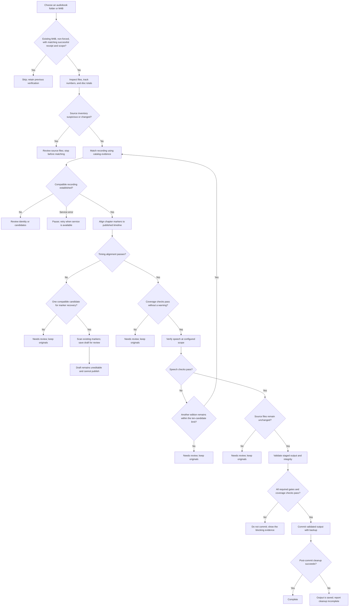

# ChapterKeeparr workflow guide

ChapterKeeparr checks each audiobook through five steps: **Inspect → Match → Align → Verify → Save**. The report shows what evidence each step found. If a required check needs review, the workflow stops and leaves the source audio in place.

## The five steps

1. **Inspect files.** Choose one audiobook folder or M4B. ChapterKeeparr fingerprints the audio files and checks available MP3 track and disc numbering for gaps, duplicates, or inconsistent totals. A suspected missing or misordered source file blocks processing until the folder is reviewed.
2. **Match the recording.** Compare title, author, narrator, language, format, and runtime evidence with catalog editions. Search results are candidates; compatibility must be checked. A provider error pauses the job for retry when the service is available. It does not mean the book or recording ID is invalid.
3. **Align chapters.** Compare local chapter markers with the selected edition’s published timeline. The timing report includes runtimes, matched and unmatched boundaries, offsets, and differences. A timing fit shows that the markers are compatible with the timeline; it does not prove that every passage is present or that speech confirms each chapter.
4. **Verify speech.** Check local speech at the required points against the proposed chapter plan. The configured scope is either sampled checks or all numbered chapters; the report identifies which was used. Named sections and credits may need separate review.
5. **Save.** Validate the staged output, check that source files have not changed, create a backup where applicable, and commit the validated result. The save gate requires the earlier checks, resolved content coverage, speech checks, and output integrity to pass.

A label such as “compatible,” “supported,” “partial,” or “unresolved” describes the evidence found for one dimension. These labels are not probabilities. Recording identity, timing, coverage, and speech verification remain separate.

## What happens when checks stop

- **Possible missing source files:** numbering or disc warnings block at Inspect so the source folder can be checked.
- **Possible content gap or edit:** an unexplained runtime shortfall greater than two seconds, or boundary differences varying by more than two seconds, blocks at Align for review. These cautious warning rules can flag harmless edition differences. No warning proves completeness: a small missing tail within the runtime tolerance, or one not reflected in the available reference timeline, can go undetected.
- **Metadata service unavailable:** the job is marked for review with a retry action. A service failure is kept distinct from a recording mismatch.
- **Other checks need review:** the report identifies the step and evidence to inspect. Resume runs the required checks again.
- **Processing fails:** operational failures are reported as failed or blocked, with the reason and report retained.
- **Cancelled before commit:** the job stops before publication and keeps the original files. Once the atomic commit begins, cancellation is no longer applied mid-commit.
- **Cleanup fails after commit:** the output has already been saved. The job reports cleanup incomplete and retains the report and backup information so the remaining cleanup can be reviewed.

## Recovery drafts

When a timing fit cannot be trusted and a single compatible edition is available, ChapterKeeparr can transcribe short clips around existing markers. The report may show spoken headings, transcripts, excerpts, and published sections that have not been located. “Supported” means the available speech evidence uniquely backs that existing marker; “unresolved” means it does not.

This scan keeps the existing marker times and produces a review-only draft. It does not edit the draft, alter chapter metadata, or publish it. Reviewing all existing markers still does not verify any new boundaries or establish full content coverage. A recovery draft can never pass the Save gate.

## Reuse and unchanged files

When a selected input is an existing M4B, a non-forced run can skip it if a successful completion receipt has an output hash matching the file and its verification scope meets the requested scope. ChapterKeeparr then retains the previous verification. A request to check all numbered chapters does not reuse a receipt from sampled verification.

For MP3 conversion, a prepared M4B may be reused only when the fingerprinted source inventory, bitrate, artwork fingerprints, and FFmpeg version match the cache key and the cached output hash is valid. This reuses the conversion work; the current job still performs its matching, alignment, speech, and output checks.

## Decision tree

A runtime or timing warning is evidence to investigate, not proof that audio is missing. Likewise, an unlocated published section is not proof that it is absent from the recording.

## 0.4.1 automatic wider marker retry

After the initial marker scan, unresolved markers receive one automatic retry using 8 seconds of pre-roll and 28 seconds after the marker, clipped to the recording. The original 2.1 seconds before / 8 seconds after heading acceptance window remains unchanged. Supported markers are not rescanned. First-pass conflicts and duplicates cannot be cleared by the retry; duplicate detection runs again. First-pass evidence is retained in `initial_attempt`; the displayed transcript and excerpt come from the retry. Reports checkpoint before retry inference, and disk/memory/excerpt bounds apply. A wider PCM excerpt gets a distinct transcript cache key; identical wider excerpts may be reused on subsequent runs. Draft publication remains disabled.

This does not add sentence-internal heading parsing. MLX versus Linux speech recognition differences still require real server validation.
