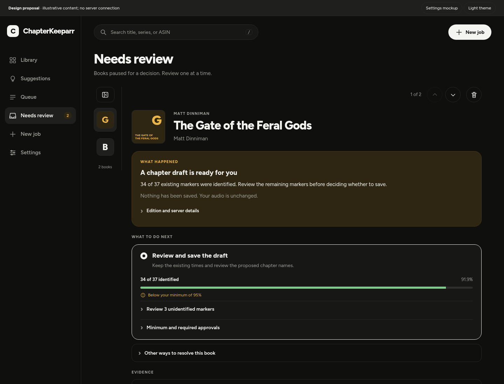
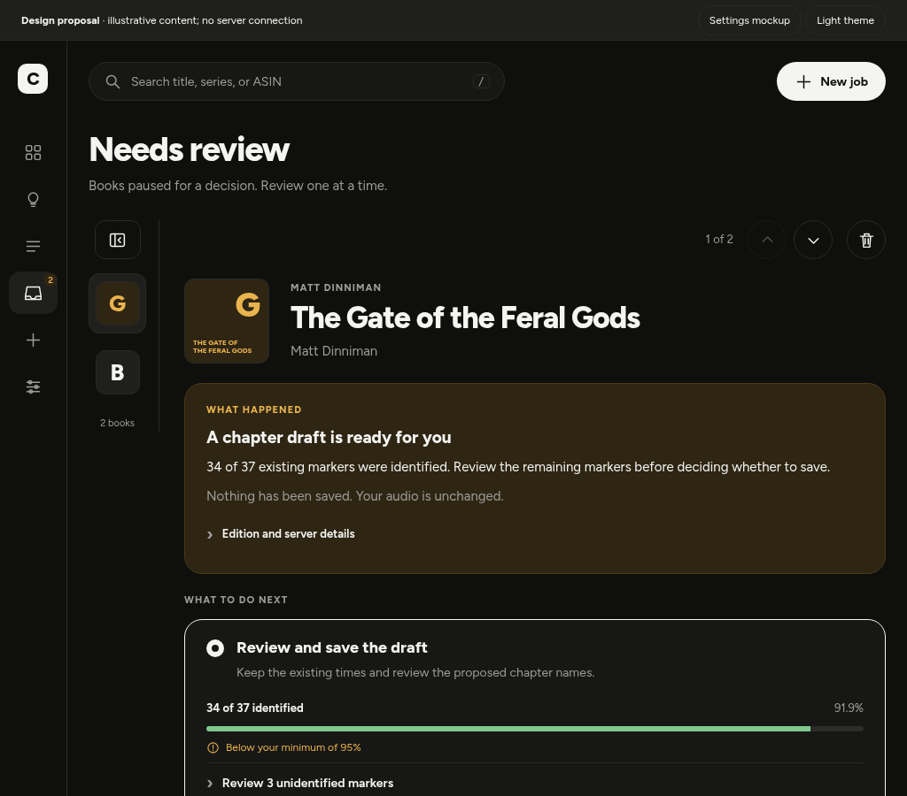
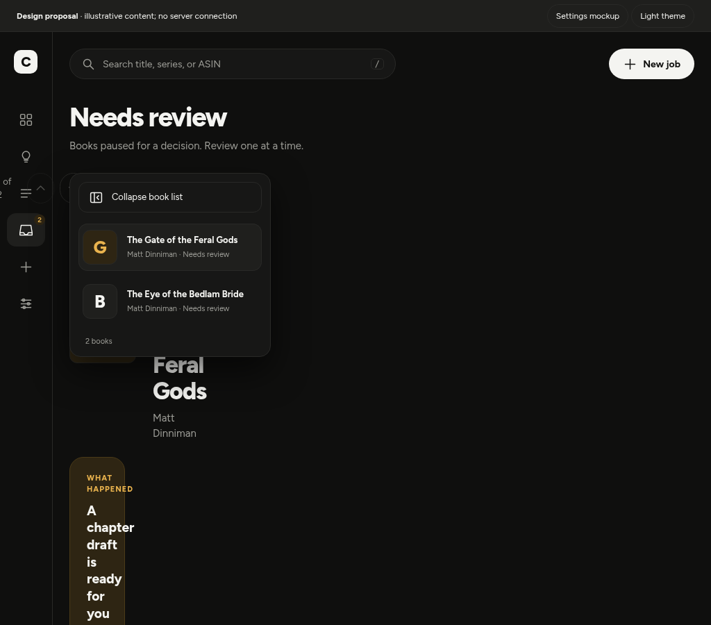
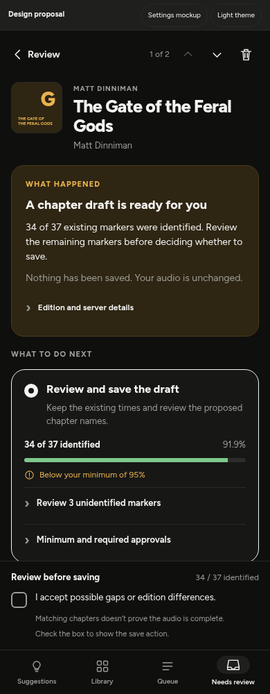
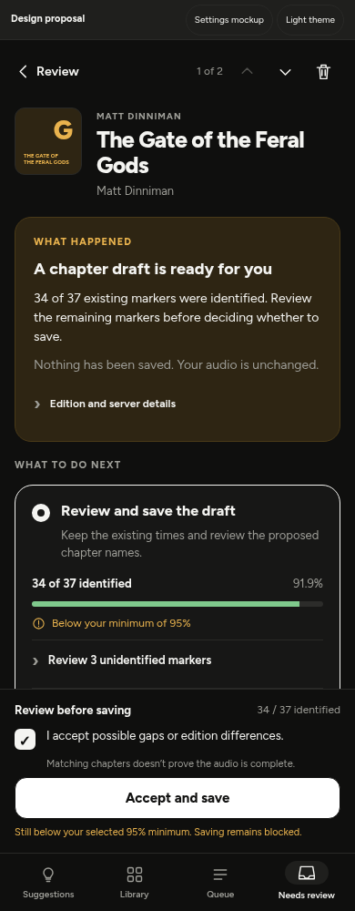
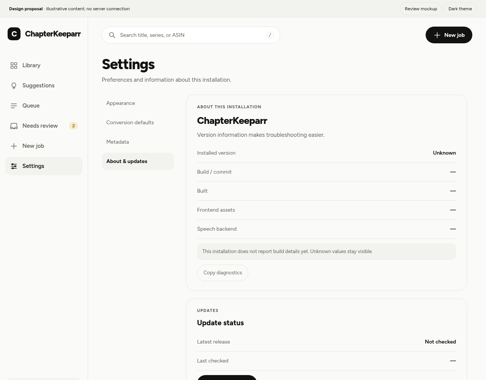

# UI/UX optimization plan

Status: finalized implementation plan; UI work precedes the backend optimization plan.
Recorded: 2026-10-19.
Audited source: main at c94c05298ec90ffa45d1d432eb6541bb4045b6a3.
Owner-provided deployment URL: http://192.168.4.51:8787 (private LAN; deployed build unknown).
No application code, publication rules, production settings, or real audiobook files were changed during this audit.

## Executive recommendation

Improve the existing design rather than replace it. Give the selected review book most of the available width, fix layouts based on usable content width, make consent and save behavior predictable, and add accurate installed-version/build information to Settings. Ship the changes in small UI PRs with responsive, keyboard, accessibility, and workflow regression checks.

The first implementation slice is the Needs review layout and acceptance interaction. The next slices address shared layouts/accessibility, workflow clarity, and Settings diagnostics. Backend throughput work remains deferred until this UI work is validated.

## Audit scope and evidence

The local preview used generated media and a throwaway fixture database, with ENABLE_WORKERS=0, browser writes blocked, and service workers blocked for repeatability. Nine route states were exercised at twelve viewport sizes in both themes: 216 screen observations plus consent checks. The route states were Library, Suggestions, Queue, review list, recovery review detail, edition review detail, Book, New job, and Settings.

Sizes: 320x740, 360x800, 390x844, 430x932, 667x375, 768x1024, 820x1180, 1024x768, 1100x800, 1280x800, 1440x900, and 1920x1080 CSS pixels. Additional checks exercised live resizing, folder-dialog Escape/focus return, edition-form preservation, skip-link behavior, larger-text stress, and axe-core checks at 390 and 1024 pixels. The five existing JavaScript test files pass.

See [audit evidence](ui-ux-audit-2026-10-19.json). Automated results and source findings are not a WCAG conformance certification.

Limitations:
- The deployed LAN app was not accessed. The supplied mobile screenshot includes a sticky acceptance footer and richer draft controls than current main, which has an inline form. Preserve the user's requested behavior when reconciling the deployed build; do not remove controls merely because they are absent from main.
- Physical iPhone/Safari, VoiceOver/TalkBack, native browser zoom, browser-chrome changes, and on-screen keyboard behavior still need device validation.
- Full-page captures showed transition-related artifacts; stable viewport captures and DOM measurements support the findings. Do not interpret capture distortion as an application defect.
- Some visually small controls have larger label/pseudo-element hit areas. Evaluate actual interactive targets, not only visible glyph bounds.

## Confirmed findings and priorities

| ID | Priority | Finding / requirement | Planned outcome |
| --- | --- | --- | --- |
| UX-01 | P0 | Review list, cover, metadata and controls compete for width. The title receives 0 px at 768, about 22 px at 820/1024, and 98 px at 1100 in fixture measurements. | Compact cover rail after selection; adaptive header and readable detail area. |
| UX-02 | P0 | An expanded desktop sidebar stays expanded while resizing into the tablet band. The review document reaches 938 px at 900/820/768 px viewport widths. | Responsive shell plus review-container adaptation, honoring explicit user choices without creating overflow. |
| UX-03 | P0 | Current main always displays an enabled Accept and save button, including with gap consent unchecked. Click-time validation blocks missing approvals, but the visible affordance is misleading. | Hide while unchecked; show white while checked; enable only when every requirement is satisfied. |
| UX-04 | P1 | Library filters and grouping/sorting controls collide at 1024 px. Stable axe checks flag obscured group/sort targets. | Reflow toolbar into rows or a compact control sheet before controls collide. |
| UX-05 | P1 | New job retains its fixed 340 px side panel through the tablet band, squeezing the source form and options. Settings retains a separate navigation column at 1024 px. | Stack by available container width; keep labels, inputs and actions readable. |
| UX-06 | P1 | Several button/segment/disclosure targets are below the project's 44 px target; small switches already have an enlarged hit area. | Audit shared target geometry and spacing without shrinking content or enlarging every icon. |
| UX-07 | P1 | Light-theme muted library metadata was flagged at about 4.18:1 contrast against a 4.5:1 requirement. | Verify and adjust shared tokens against actual surfaces in both themes. |
| UX-08 | P1 | Settings version is a placeholder; health returns only status. | Installed version/build identity, useful diagnostics, and honest update-check states. |
| UX-09 | P1 | The skip link uses #view, while the hash router redirects unknown fragments to Library. | Focus main content without changing the current route. |
| UX-10 | P1 | Review instructions, multiple alternate paths and long warnings compete with the current decision. | Clear next action, compact context, evidence on demand, and actionable blockers. |
| UX-11 | P2 | Font availability, polling, transitions, sticky regions and PWA cache versions affect perceived stability. | Stable inputs/scroll/focus, local fonts, lightweight rendering, safe asset refresh. |

The folder browser already supplies dialog semantics, Escape dismissal and focus return in the tested flow. Edition search input survived switching decision sections. Preserve these strengths.

## Visual mockups and interactive prototype

These are documentation-only proposals, not screenshots of an implemented update. Cover placeholders are illustrative. The 34/37 marker count comes from the supplied screenshot; the installed version stays Unknown because the deployed build has not been identified.

### Desktop: compact book rail

The cover-only rail gives the decision pane the available width. The selected book retains a full readable title; navigation controls sit on their own row. The expand control remains visible above the covers.

### Windowed desktop: compact versus expanded

| Compact rail at 1024 px | Expanded book list at 1024 px |
| --- | --- |
|  |  |

At this width the expanded list overlays the rail area rather than compressing the reading pane. Expand/collapse works by button, and Escape closes the temporary list. Hover and focus title previews supplement full accessible names.

### Mobile: checkbox off and on

| Unchecked: save action hidden | Checked: white save action appears |
| --- | --- |
|  |  |

The footer shrinks when the action is hidden. In the shown example, 34/37 is 91.9%, below the default 95% minimum: checking consent reveals the white action but does not bypass that requirement. The nearby explanation states why saving is still blocked. Once all real requirements are met, the implementation enables the same white control.

### Settings: About and updates

Installed version, build/commit, build date, frontend assets, speech backend and update-check state have a dedicated home. Unknown values remain honest. See the [mobile Settings mockup](mockups/settings-about-mobile.png).

### Try the interactions

Open [the interactive prototype](mockups/index.html) locally using the [preview instructions](mockups/README.md). It demonstrates rail expansion, theme switching, Review/Settings views and checkbox off/on/off behavior. It does not contact the app or save an audiobook.

Prototype checks confirmed no page overflow in the seven captured states, white button styling, off/on/off visibility, continued blocking below the minimum, and rail expansion/Escape. These checks apply to the proposal prototype, not an implemented production fix.

## 1. Needs review: selection and layout

### Compact book rail requested by the owner

- Before a selection, show the readable book list.
- Selecting a book on desktop/tablet collapses the list to a compact vertical rail of covers, approximately 76-88 px wide, subject to testing.
- Provide a persistent Expand book list / Collapse book list button with aria-expanded and aria-controls. This is distinct from the global application sidebar.
- Retain clear selected-book styling and an accessible full title/author/status for every cover link. Use native links and a predictable tab order.
- Show a non-interactive title preview on pointer hover and keyboard focus; make it dismissible with Escape and avoid clipping against scroll containers. Hover is an enhancement, never the only way to identify or select a book.
- At intermediate widths, expansion should overlay or replace the rail temporarily rather than squeeze the reading pane. Closing it restores focus to the selected cover or trigger.
- Keep the rail scrollable for long lists. Polling must not change the selected book, reorder it under focus, or reset the user's position.
- On phones, keep list and detail as separate views with Back to review. Do not spend horizontal detail space on a persistent cover rail.

### Detail header and breakpoints

Use available content/container width, not only the 767 px phone breakpoint. Maintain an approximately 480-600 px usable detail area when space permits; fall back to a single pane before text is compressed.

Place previous/next/count/cancel controls in a separate compact header row when necessary. Let the title and metadata wrap normally, reduce cover size at narrower widths, and avoid a row that forces a cover, title and three buttons side by side. Never solve the problem by clipping the title or reducing the reading text to a tiny size.

Honor an explicit global-sidebar preference, but ensure the content can reflow even with the sidebar expanded. With no explicit preference, adapt the global sidebar to the current viewport as it changes. Keep review-list expansion state separate from global-sidebar state.

## 2. Mobile consent and Accept and save

The owner's requested behavior is authoritative:

| Gap acceptance checkbox | Save control |
| --- | --- |
| Unchecked | Hidden, absent from keyboard tab order and the accessibility tree; no empty button-sized gap. |
| Checked | Visible with a white background and dark readable label. |
| Unchecked again | Hidden immediately. |
| Checked, other requirements missing | Remains visible and white; saving blocked with a nearby explanation. |
| All requirements satisfied | Enabled. |
| Submission underway | Busy label, duplicate submissions blocked. |
| Submission fails | Preserve valid edits/approvals and show an actionable error; require review again if evidence changed. |

Use a named shared token for the white review action in both themes, with sufficient text and boundary contrast, rather than an inline color. This explicitly updates the existing theme-primary convention for this control.

Visibility depends on the checkbox; authorization depends on the entire existing acceptance predicate: minimum coverage, required per-section approvals, preserving unresolved markers where required, current draft/source identity, connection and busy state. Keep server validation authoritative. Do not lower the minimum, automatically accept exceptions, or infer audio completeness.

Use one shared predicate in inline and sticky variants. Checkbox changes must cause an immediate state/render update. Keep keyboard focus on the checkbox when the action appears. Announce availability changes politely without moving focus or repeatedly reading the whole form.

For the deployed sticky footer, collapse its height when the action is hidden. Reserve bottom content space from actual footer/tab-bar dimensions and safe-area insets. The footer must not cover evidence, form fields or focused controls. On short landscape/keyboard-constrained viewports, use a compact summary or in-flow action area instead of occupying most of the screen.

Show concrete blockers such as the actual identified count/percentage and selected minimum. A user who checks consent while below the minimum must be able to understand what remains required. Keep consent text available when the button is hidden.

## 3. Review workflow and the rest of the app

### Review workflow

The reading order is: selected recording and reason -> proposed outcome -> evidence and unresolved items -> explicit acceptance -> save/re-verify -> queue acknowledgement -> final result.

Keep What happened concise. Show the recommended decision path first, with alternate edition search/rescan/retry paths under a clear secondary disclosure. Preserve all supported capabilities and keep human wording separate from server diagnostics.

Retain unsaved fields, disclosure state and playback context across polling and resizing. Reset approval when the reviewed evidence/draft identity changes. Explain whether an action queues checks, queues finalization, or completes a save; do not say Saved before validation/commit finishes. Return to a stable review list or queue link and do not automatically switch to a different book.

### Library and Suggestions

Reflow filters, grouping, sorting and view controls before they overlap. On narrow content widths, use two rows or the existing compact sheet. Keep the selected filter visible and horizontal filter scrolling discoverable and keyboard accessible. Test long titles/author names and many groups.

Distinguish real suggestions from unavailable integrations. Explain unavailable capabilities in user language. Keep internal G-xxx references in development documentation or diagnostic details, not primary product instructions.

### Queue and Book

Keep current stage and the next useful action readable at tablet widths. Distinguish Queued, processing, awaiting a decision, cancellation requested, failed and completed outcomes using the established status adapter. Preserve measured progress wording and avoid fabricated completion times.

Wrap long file paths and metadata; adapt chapter/evidence rows without losing their labels or preview actions. Preserve 15-second spot checks and their accessible stop control. Avoid collisions between preview controls, tab bars, notifications and any acceptance footer.

### New job and Settings

Stack the New job summary panel when the form cannot retain a usable width. Preserve the browse -> scan -> select -> options -> queue sequence, selected-book counts and server-path explanation. Unsupported edition/output controls should be clearly explained rather than appearing broken.

For Settings, collapse section navigation and stack label/control rows based on content width. Show which settings are per-device, server-wide or read-only startup configuration. Make autosave, saving, validation and failures explicit; token entry remains an explicit Save operation.

## 4. Settings: About, version and updates

Expand existing G-024; do not create a second competing version contract.

Display:
- Installed server version and release channel/tag.
- Build/commit identifier and build date, when available.
- Frontend asset/build identifier, to diagnose stale PWA/browser assets.
- Current speech backend/model and useful configured resource limits.
- Last update-check time, latest compatible release when known, and Check for updates / View release notes.
- Copy diagnostics, excluding tokens, credentials and unnecessarily detailed private paths.

Generate version identity from a single build/release source; do not infer it from a README heading, mutable latest tag, or stale browser cache. Missing fields show Unknown or —. Update checks must distinguish checking, update available, current, unavailable and unable to determine. Private GitHub/GHCR authentication and rate-limit failures must never be presented as Up to date.

Checking for an update does not pull an image, restart the container, merge code, or publish a release. Provide clear deployment-specific instructions. Announce an asset update and offer a safe reload when there are no unsaved decisions; never force a reload during review.

## 5. Accessibility and interaction requirements

Target WCAG 2.2 AA and retain the project's 44x44 px interactive-target standard. The WCAG AA minimum has spacing/exception rules; a small visual glyph alone is not a failure.

- Reflow ordinary content to 320 CSS px without two-dimensional page scrolling. Test 200% text and native zoom up to 400%; the existing larger-text stress test is not a native-zoom certification.
- Normal text contrast at least 4.5:1; large text 3:1; meaningful control/focus boundaries 3:1. Check both themes and status states.
- Complete keyboard access, visible focus, useful landmarks/headings, and names for icon/cover controls.
- Fix the skip link so it focuses main content without changing the hash route.
- Hidden save buttons must not be focusable. Hover previews also work on focus/touch and dismiss with Escape.
- Dialogs trap focus and return it to the correct trigger. Verify background isolation with assistive technology.
- Sticky bars, safe areas, software keyboards and browser chrome must not obscure the focused element.
- Field errors associate with inputs and explain correction. Status announcements are concise and avoid repeated polling chatter.
- Use native controls/disclosures where appropriate; custom stateful controls expose correct expanded/pressed/selected states.
- Honor OS and app reduced-motion preferences. Preserve reduced-motion behavior and test actual transitions separately.
- Run VoiceOver on iPhone and one desktop screen reader before calling the accessibility work complete.

References: [WCAG reflow](https://www.w3.org/WAI/WCAG22/Understanding/reflow.html), [focus not obscured](https://www.w3.org/WAI/WCAG22/Understanding/focus-not-obscured-minimum.html), [target size](https://www.w3.org/WAI/WCAG22/Understanding/target-size-minimum.html).

## 6. Performance and implementation boundaries

Use the existing ES modules, components, tokens, overlays and status adapter; no new framework is needed. Reuse thumbnail caching, load detailed evidence on demand, avoid duplicating hidden desktop/mobile forms, and preserve DOM/input state on unchanged polls. Use CSS/container queries for layout, with measured resize work where needed.

Preserve source fingerprints, acceptance tokens, publication gates and backups. Keep button appearance separate from authorization. Frontend changes must not change chapter matching or acceptance thresholds.

Update DESIGN.md/SCREENS.md to record the approved cover rail and white action behavior during implementation; document real backend contracts in GAPS.md. This planning PR deliberately does not imply those changes already exist.

## Delivery order and release criteria

1. Review workspace: compact cover rail, adaptive header, live-resize behavior, consent/save interaction and focused regression tests.
2. Shared responsive components: Library toolbar, New job, Settings, long metadata, hit areas and contrast.
3. Workflow polish: blockers, draft preservation, queue acknowledgement, empty/loading/offline/auth/error states, preview/footer stacking.
4. About/version contract and frontend display, private-release update handling and diagnostic copy.
5. Final responsive/accessibility/device validation and documentation refresh.

Every PR uses generated/copy fixtures; no real library publication is needed for UI tests. Keep a representative long title and multiple narrators in responsive fixtures.

Release criteria:
- No title collapse, obscured controls or page overflow at the audited sizes, near breakpoints (767/768, 1023/1024, 1099/1100/1101), during live resize, and with either sidebar state.
- Review rail can collapse/expand by pointer, touch and keyboard without losing the selected book.
- Checkbox off/on/off behavior is exact; white action styling works in both themes; remaining requirements still block saving.
- Inputs, focus, scroll, selection and approvals remain correct across polling, orientation changes and failed requests.
- No accidental submission, duplicate save, auto-acceptance or approval reuse after evidence changes.
- Version/build/update data is factual and useful even when release access is unavailable.
- Automated accessibility checks have no unexplained serious/critical findings; keyboard and real-device assistive-technology checks pass.
- Existing JavaScript/design/backend acceptance regressions pass, plus focused browser tests for the new behavior.
- PWA refresh and deployed-build identity are verified on the owner's actual installation before release.

